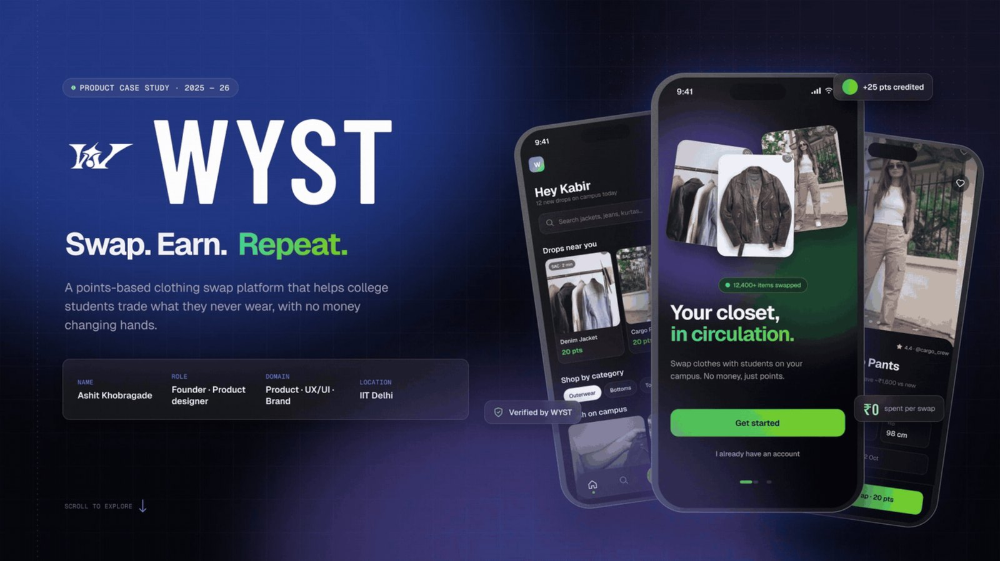
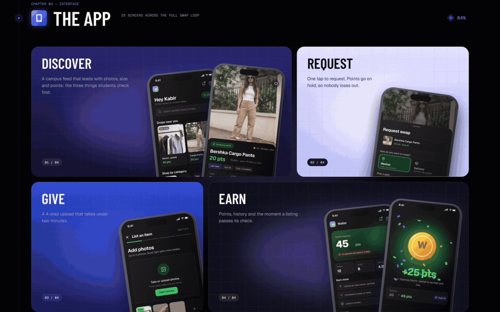
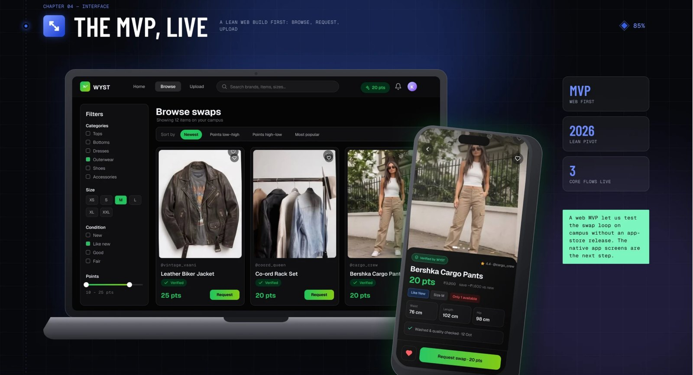
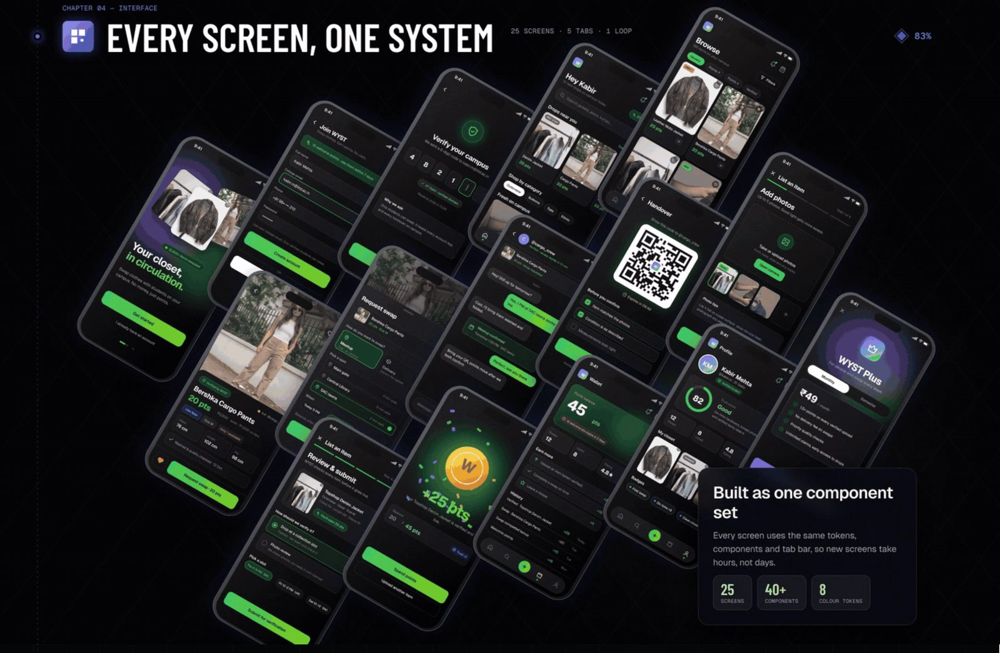
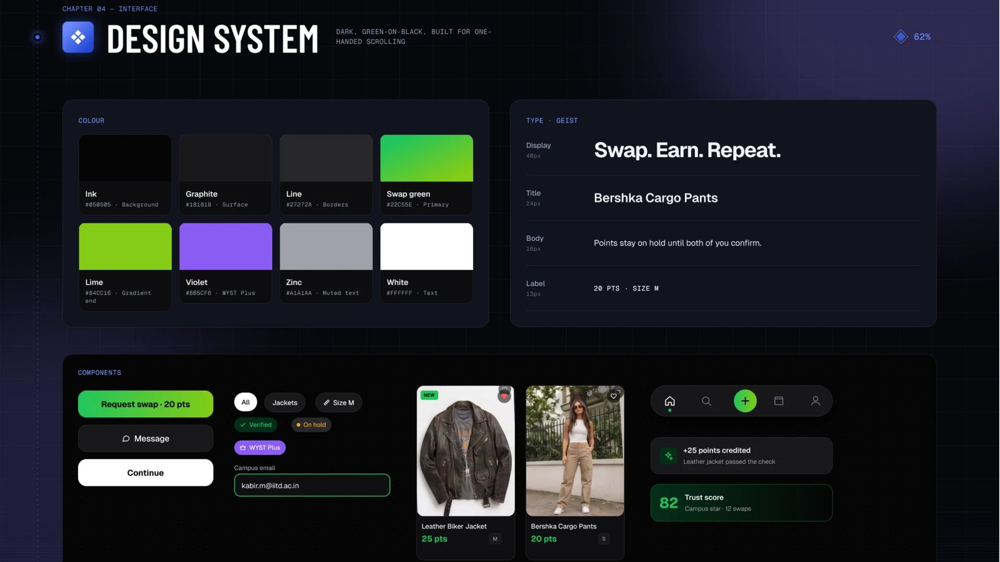

<div align="center">

# WYST

**Swap. Earn. Repeat.**

A peer-to-peer clothing swap platform for college students. Give the clothes you never wear, earn points, and swap them for something you will.

[**Live demo →**](https://wyst-app.vercel.app) &nbsp;·&nbsp; [Case study](https://ashitdesign.framer.website/work/projects/wyst) &nbsp;·&nbsp; [Behance](https://www.behance.net/ashitkhobragade1)




</div>

---

## The problem

College students own clothes they never wear, selling them is a hassle, buying new is expensive, and strangers on resale apps aren't trusted. Meanwhile India piles up around 7.8 million tonnes of textile waste every year.

WYST makes swapping clothes on campus easier and more trustworthy by combining a **points-based exchange** with **verified users**, **curated listings** and a simple way to discover what's nearby.

## How it works



1. **Discover** — browse listings from students on your campus, filtered by category, size and condition.
2. **Request** — ask for an item and pay in points, not money.
3. **Give** — list something you don't wear in a few steps.
4. **Earn** — get points when someone swaps your piece, then spend them on your next find.

## Features in this MVP

- **Browse** with filters for category (tops, bottoms, dresses, outerwear, shoes, accessories), size, condition and swap preference (meetup or delivery), and sorting by newest or most popular.
- **Listing pages** with photos, brand, size, colour, condition badge, verified-seller tag and similar items.
- **List an item** in four steps: upload photos, item details, set a points value, review and submit.
- **Dashboard** with your points balance, my listings, incoming and outgoing requests, wishlist, transaction history and profile settings.
- **Wishlist** and points balance shared across the app with a Zustand store.
- **Sign up and log in** screens.
- **Responsive** layout for phones and desktops.

> This is a front-end MVP. Listings are sample data in `src/lib/listings.ts` and the user is mocked in the store; there is no backend or real authentication yet.



## Design

WYST started as a design project: research with students on campus, personas, journey maps, the points economy and a full mobile design system, before any code was written.





Read the full process in the [case study](https://ashitdesign.framer.website/work/projects/wyst).

## Tech stack

| | |
| --- | --- |
| Framework | [Next.js 16](https://nextjs.org) (App Router) |
| UI | React 19, TypeScript |
| Styling | Tailwind CSS 4 |
| State | [Zustand](https://github.com/pmndrs/zustand) |
| Hosting | Vercel |

## Run it locally

```bash
git clone https://github.com/assshitt/Wyst-App.git
cd Wyst-App
npm install
npm run dev
```

Then open [http://localhost:3000](http://localhost:3000).

| Script | What it does |
| --- | --- |
| `npm run dev` | start the dev server |
| `npm run build` | production build |
| `npm start` | serve the production build |
| `npm run lint` | run ESLint |

## Project structure

```
src/
├─ app/                  routes (App Router)
│  ├─ page.tsx           home
│  ├─ browse/            browse and filter listings
│  ├─ listing/[id]/      listing detail
│  ├─ upload/            list an item
│  ├─ dashboard/         points, listings, requests, wishlist
│  ├─ login/  signup/    auth screens
├─ components/           Navbar, ListingCard, UploadForm, Dashboard, ...
├─ lib/listings.ts       sample listings
└─ store/userStore.ts    user, points and wishlist (Zustand)
```

## Roadmap

- [ ] Real accounts with college email verification
- [ ] Database and image storage for listings
- [ ] In-app chat and QR handover to confirm a swap
- [ ] Points ledger on the server, with anti-abuse checks

## About

Founded, designed and built by **Ashit Khobragade**, a design student at IIT Delhi.

[Portfolio](https://ashitdesign.framer.website) · [LinkedIn](https://www.linkedin.com/in/ashit-k-4b14412b8) · [Behance](https://www.behance.net/ashitkhobragade1) · [Instagram](https://www.instagram.com/assshitt_/)
